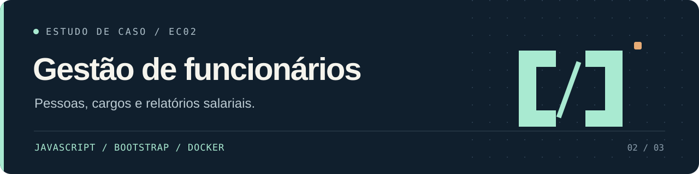
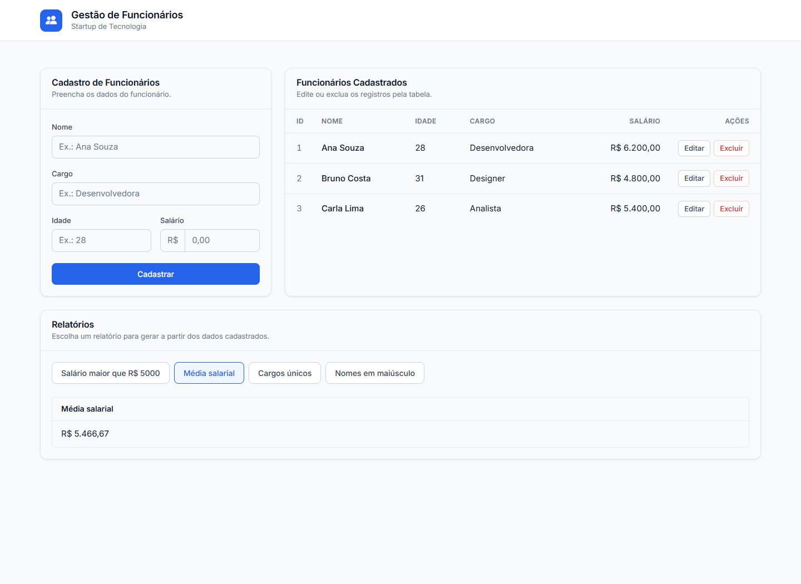

# Gestão de funcionários

Aplicação web para cadastrar funcionários, atualizar seus dados e consultar relatórios salariais. Um estudo de orientação a objetos e recursos modernos do JavaScript, com HTML5, Bootstrap 5 e CSS próprio.

**[Experimentar a demonstração →](https://tiagoversiane.github.io/ec02-gestao-funcionarios/)** · [Executar localmente](#executar-localmente) · [Conceitos aplicados](#conceitos-aplicados)



<details>
<summary>Ver a interface no celular</summary>

<p align="center"></p>

</details>

## Funcionalidades

- Cadastrar, listar, editar e excluir funcionários.
- Gerar identificadores durante a execução.
- Consultar funcionários com salário superior a **R$ 5.000,00**.
- Calcular a média salarial, formatada em reais.
- Listar cargos sem repetição e nomes em letras maiúsculas.
- Validar o preenchimento do formulário com HTML5.

## Conceitos aplicados

A classe `Funcionario` utiliza **campos privados, getters e setters**. O contador estático privado `#proximoId` gera os identificadores; os métodos `atualizar` e `toString` reúnem operações do modelo.

No tratamento dos registros, `find` localiza funcionários, `filter` seleciona ou remove, `map` transforma e `reduce` calcula valores agregados. Um `Set` reúne os cargos sem repetição. O código também aplica spread e arrow functions.

| Tecnologia | Uso |
| :--- | :--- |
| HTML5 | Estrutura e validação do formulário |
| Bootstrap 5 | Componentes e estilos, carregados por CDN |
| JavaScript | Modelo, eventos, cadastros e relatórios |
| Docker e Nginx | Ambiente opcional para servir os arquivos estáticos |

## Executar localmente

```bash
git clone https://github.com/tiagoversiane/ec02-gestao-funcionarios.git
cd ec02-gestao-funcionarios
```

Escolha uma das opções abaixo. Não é necessário instalar dependências JavaScript.

### Com Docker

Com Docker e Docker Compose instalados e em execução:

```bash
docker compose up --build
```

Abra **[http://localhost:8081](http://localhost:8081)**.

O Nginx serve a pasta `src`, montada pelo Compose como volume somente para leitura. Para encerrar, pressione `Ctrl+C` e execute `docker compose down`.

### Com Python 3

Na raiz do projeto:

```bash
python -m http.server 8081 --directory src
```

Abra **[http://localhost:8081](http://localhost:8081)**. Use `Ctrl+C` para encerrar.

Utilize um navegador atualizado e acesso à internet para carregar os recursos visuais externos.

## Estrutura

```text
ec02-gestao-funcionarios/
├── .github/workflows/   # Publicação da demonstração no GitHub Pages
├── assets/banner.svg   # Identidade visual do repositório
├── docs/interface.png  # Captura da interface
├── src/
│   ├── index.html
│   ├── css/
│   │   └── estilo.css
│   └── js/
│       ├── Funcionario.js
│       └── app.js
├── Dockerfile
├── docker-compose.yml
└── README.md
```

## Função anônima tradicional e arrow function

O estudo compara duas formas de escrever a busca por identificador.

```javascript
// Função anônima tradicional
const buscarPorId = function (id) {
  return funcionarios.find(function (funcionario) {
    return funcionario.id === id;
  });
};

// Arrow functions e retorno implícito
const buscarPorId = (id) => funcionarios.find((funcionario) => funcionario.id === id);
```

As duas versões acima representam alternativas de implementação. Arrow functions também podem ser anônimas e, além da sintaxe curta, não criam um `this` próprio: usam o contexto em que foram definidas.

## Escopo

Projeto acadêmico com registros em um array na memória do navegador. **Recarregar a página apaga os cadastros.** A aplicação não possui backend nem banco de dados; o Docker serve os arquivos estáticos e não adiciona persistência.

A demonstração online usa o mesmo código da pasta `src`. A publicação é atualizada pelo GitHub Actions quando essa pasta muda.

---

Desenvolvido por [Tiago Versiane](https://github.com/tiagoversiane) · [Conheça os outros projetos](https://github.com/tiagoversiane#estudos-de-javascript)
